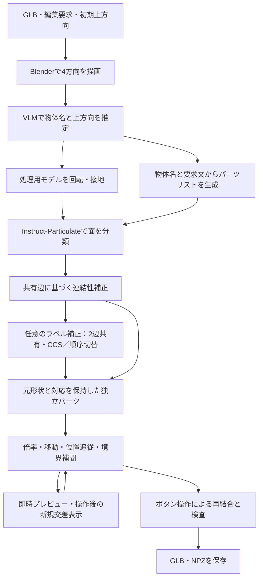

# MeshTailor：要求に応じた意味的分割と境界を考慮した変形による既存3Dメッシュの対話的編集

**論文草案・途中経過報告／2026年11月15日**

本稿は、提供された研究説明の草案と、このワークスペースの実装を照合して再構成したものである。研究目標、実装済みの試作機能、今後の提案、未実施の評価を区別する。以下の本文は現行プロトタイプを中心に記述し、初期版の機能や調査結果を現行版の実績として扱わない。

コード照合時点のコミットは `df9851cb2115b084ba0e75ecf9dedba7c67c3e30` である。照合対象はWindows側の開発ワークスペースと、WSLへ配置する追加モジュールであり、稼働中のWSL環境がこのコードと一致することを今回確認したわけではない。コードと開発会話から確認できる実装内容を記載し、推論精度、応答速度、造形成功率の実験結果は補っていない。

---

## 概要

既存の3Dメッシュを個別の使用条件に合わせるには、モデルの特徴を維持しながら、必要な領域の寸法や形状を変更する必要がある。しかし、配布されるメッシュには意味的なパーツ構造や編集パラメータが付与されていないことが多い。また、パーツを独立に変形すると、接続部のずれ、急な段差、面の交差が生じ得る。

本研究では、自然言語による編集要求に応じて既存メッシュを意味的なパーツへ分割し、境界と接続関係を参照しながら対話的に編集するMeshTailorを提案する。現行プロトタイプは、多視点画像を用いた物体名・上方向の推定、物体名と編集要求に基づくパーツリスト生成、Instruct-Particulateによるテキスト条件付き分割を接続する。分割後は、共有辺に基づく連結性補正と、任意に実行できる二種類のラベル補正を提供する。編集では、可変数のパーツに対する一様スケーリングと三方向移動に加え、接続先の位置追従、境界付近の変形量の補間、断面を固定する移動を実装した。さらに、未編集時との差分に基づく面交差の可視化と、元の頂点対応を用いた再結合を行う。

本稿では、これらの処理をつなぐデータ表現と実装を報告し、要求に適した分割、接続部の形状保持、操作性を調べる評価計画を示す。現段階では、水密性、強度、3Dプリント適合性の保証と、それらを達成する自動修復は研究課題として残る。

**キーワード：** 3Dメッシュ編集、自然言語インタフェース、意味的分割、パラメトリック編集、境界変形、デジタルファブリケーション

## 1．背景と研究目的

### 1.1 既存モデルを利用者の条件へ合わせる

3Dモデルの共有は、利用者が一から形状を設計する負担を減らす。一方、既存モデルの寸法や形状は、設置場所、組み合わせる物品、持ち方などの個別条件に合うとは限らない。例えば、ヘッドホンスタンドの高さを変える場合、全体を拡大すると台座やヘッドホンを支える部分も同時に変化する。利用者が必要とするのは、気に入った特徴を残しながら、支柱などの特定領域を調整することである。

この編集には二つの難しさがある。第一に、メッシュには「台座」「支柱」「取っ手」といった編集対象が明示されていない場合がある。第二に、対象領域だけを変更すると、その領域と周囲との接続形状が不整合になる。したがって、編集操作だけでなく、編集領域の構成と接続部の扱いも支援する必要がある。

### 1.2 要求に応じて編集単位を構成する

物体を構成するパーツの唯一の正解を求めるだけでは、編集支援には十分でない。同じ物体でも、「全体を大きくしたい」場合と「支柱だけを長くしたい」場合では、必要な分割粒度が異なる。本研究では、使用目的や編集要求を、分割後の操作だけでなく、分割単位の決定にも利用する。

その際、対象領域以外を未定義のまま残すことはできない。後段の分割器は与えられたパーツリストを用いてモデル全体を分類するため、編集しない領域も含めて、全体を覆う互いに重複しない領域を計画する必要がある。

### 1.3 研究目標と現在の到達点

研究全体の目標は、編集用注釈のない既存メッシュを、使用目的に応じて調整でき、最終的に製作へ利用できる形状へ変換することである。現行版では、このうち、要求に応じたパーツ構成、独立パーツ編集、境界を考慮した変形、接続情報による再結合までを試作した。

ただし、「一つのMeshとして出力できること」と「単一の閉じた有効な立体になること」は異なる。本稿は、造形までの全工程が完成したシステムとしてではなく、そのための編集基盤と、残る幾何学的課題を報告する。

本研究では、次の問いを扱う。

- **RQ1：** 物体名と編集要求を用いて、モデル全体を覆いながら、要求に必要な編集単位を構成できるか。
- **RQ2：** 元の接続関係と境界からの距離を利用することで、独立パーツ編集に伴うずれや急な段差をどの範囲で抑えられるか。
- **RQ3：** 形状の即時表示、補正段階の比較、新規交差の可視化は、利用者による調整と問題の発見を支援するか。

## 2．関連研究と位置づけ

### 2.1 パーツ構造の抽出

PartFieldは、学習済みの3D特徴場から、パーツに対応する特徴を抽出し、クラスタリングによる階層的分解などに利用する手法である。初期MeshTailorは、このような幾何に基づく分割を編集単位の獲得に利用していた。現行版では、編集要求から決定した名称を条件として与える構成へ変更した。PartField自体の特徴場と、本システムが採用する分割手順は区別する。[PartField公式ページ](https://research.nvidia.com/labs/toronto-ai/partfield-release/)

Instruct-Particulateは、静的メッシュとパーツ・接続・関節などの指定から、分割と関節パラメータを推定する学習済みモデルである。本システムはその公開実装を利用するが、対象は剛体オブジェクトの形状編集であるため、関節生成を目的とせず、パーツ名を用いた分割機能を呼び出す。分割器の学習やモデルそのものは本研究の貢献に含めない。[Instruct-Particulate公式ページ](https://instruct-particulate.github.io/)

### 2.2 自然言語によるパラメトリック編集

ParSELは、自然言語要求をパラメータ化された編集へ変換し、パーツ間関係を考慮した編集の伝播を扱う。したがって、「言語とスライダーを組み合わせる」「接続関係に配慮する」という点だけでは、本研究との差分にならない。本研究では、未分割メッシュから要求に応じて編集単位を構成する過程と、元メッシュの境界対応を保持した局所変形・再結合を含む過程を具体化する。優位性を主張するには、入力条件と評価課題を揃えた比較が必要である。[ParSEL公式ページ](https://bardofcodes.github.io/parSEL/)

### 2.3 ファブリケーションを目的とする編集

Style2Fabは機能に関わる領域を保護しながら外観を変更する。本研究は、取っ手の大きさや支柱の寸法など、機能に関わる領域そのものを調整することを目指す。InstructMeshは生成3Dモデルの局所的な欠陥を、中間表現への操作によって修正する。本研究では、既存の三角形メッシュを直接編集し、元の面・頂点対応を後段で利用する点に焦点を置く。これらの違いは対象と処理の違いであり、性能上の優位性を意味しない。[Style2Fab論文](https://arxiv.org/abs/2309.06379)、[InstructMesh論文](https://arxiv.org/abs/2608.28534)

### 2.4 本研究で検証する貢献候補

本研究の貢献候補は、次の三点に整理する。

1. 物体認識、要求に応じた分割計画、独立パーツ編集を接続し、編集用注釈のない既存メッシュへ適用するワークフロー。
2. 元の面・頂点対応と接続境界を維持し、位置追従、境界付近の補間、断面固定移動、再結合へ共通して利用する実装構成。
3. 分割後補正の段階比較と、未編集時を基準とする交差可視化を含む、利用者による確認・調整の仕組み。

個々の要素には既存の手法や標準的な数値処理を用いる。これらを新しい分割モデルや新しい変形理論として主張せず、組み合わせによって何が可能になったかを評価する。

## 3．システム概要

### 3.1 入力と出力

入力はGLB形式の3Dモデル、自然言語による編集要求、および初期の上方向に関する設定である。作成者によるパーツ注釈やCADの設計履歴は要求しない。一方、あらゆる欠損・非多様体・自己交差を含むメッシュへの対応は仮定しない。

出力は、分割された独立パーツ、パラメータ値に応じた編集形状、元の接続境界を利用して再結合した形状、および各段階の対応情報と診断情報である。現行UIの保存形式はGLBとNPZであり、造形適合性を検証したSTL出力は未実装である。

### 3.2 処理の流れ

LLMによるパーツ計画は物体名と要求文のみを入力とし、姿勢補正後の画像やメッシュを直接参照しない。上図の姿勢補正とパーツ計画は、物体名・上方向推定後の役割の違いを表しており、並列実行を意味しない。

### 3.3 実行環境の分離

Windows上のStreamlitが入力・表示・編集操作を担当し、WSL上のFastAPIがモデル登録、Blender描画、Gemini API呼び出し、Instruct-Particulate推論、分割後補正を担当する。両者はHTTP APIで通信し、Windows側はWSLの内部パスではなくAPIから成果物を取得する。旧SegmentDesign3Dは別に保持し、現行の試作UIとバックエンドを追加している。

学習済み分割モデルの推論はGPUを利用する構成である。一方、追加した連結性補正、二種類のラベル補正、境界距離の計算、編集確定時の幾何処理・交差検査はCPU側で行う。ドラッグ中の形状表示はブラウザ内のThree.jsで更新する。GPU推論、CPU幾何処理、表示用の描画処理は異なる工程である。

## 4．物体理解と要求に応じたパーツ計画

### 4.1 多視点画像による物体名の推定

登録したメッシュをBlenderで4方向から描画し、同一物体の複数視点としてGeminiへ与える。物体名は、完全なオブジェクトの短い日本語カテゴリ名を返すよう指示する。ブランド、製品番号、材質の断定は求めず、不明な場合は「不明」とする。

これは本研究専用の物体分類器を学習する処理ではなく、外部の学習済みVLMへの推論である。物体名推定のために本研究独自の教師データで追加学習する処理は実装していない。また、日本語出力はVLMの必然的な性質ではなく、システムプロンプトで明示した出力条件である。

物体名だけを取得するモードと、次節の上方向も同時に取得するモードがある。モデルIDは設定可能であり、論文の実験条件には実行記録に保存されたIDを記載する。開発会話で指定されたモデル名と、実際の試験で使用したモデルの同一性は、ログで確認する必要がある。

### 4.2 上方向の推定と接地

自動姿勢調整を有効にすると、同じ4画像と同じVLM呼び出しを使って、物体名と三次元の上方向ベクトルを取得する。各画像にはカメラの基底を添え、複数画像に共通する描画座標系で方向を回答させる。追加の候補画像生成や姿勢確認用のVLM再呼び出しは行わない。

現在のプロンプトは、識別可能な持ち手が一つある物体について、持ち手側を低いZ、主要な本体・作用部を高いZへ置く規則を優先する。持ち手がない場合は通常使用時の上下を使い、複数の持ち手などで一意に決められなければ推定不能とする。この規則はプロンプト上の条件であり、VLMを再学習したものではない。マグカップなどでは通常の置き方と異なる姿勢になる可能性がある。

推定方向を \(u\)、+Zの単位ベクトルを \(e_z\) とすると、Python側で \(Ru=e_z\) を満たす剛体回転を求める。その後、参照されるメッシュ頂点の最小Zを引き、最下点をZ=0へ置く。推定不能ならユーザの初期上方向を用いる。寸法の拡大縮小は行わない。

この処理が決めるのは上下である。Z軸回りの正面、底面に最も適合する支持平面、最適な印刷姿勢は推定しない。最下点をZ=0へ置くことと、底面全体がXY平面に載ることは異なり、上方向の誤差があれば底面の傾きは残る。

元GLBを保持したまま処理用のGLBを作成し、変換行列と逆行列を保存する。入力プレビュー、分割、編集、再結合はこの姿勢と座標に整合させ、表示の回転を二重に適用しない。

### 4.3 編集要求からの最小限のパーツ構成

物体名と要求文を、別のテキスト入力によるGemini呼び出しへ渡す。現行プランナにはメッシュや画像を渡さず、物体カテゴリに関する知識と要求文から構成を推論させる。したがって、その出力は実物の幾何を確認した結果ではなく、後段で検証すべき分割計画である。

プランナへの主要な指示は次のとおりである。

- 物体カテゴリから、構成していると考えられるパーツを考える。
- 要求を満たすために必要な領域を独立させ、必要最小限の分割にする。
- 編集しない領域を含めてモデル全体を覆い、領域同士を意味的に重複させない。
- 全体への編集なら一領域でよい。物体全体とその構成パーツを重複した領域として同時に列挙しない。
- 接続先を独立に位置調整する必要がある場合は、その領域を別パーツとして保つ。
- 未確認の接続や形状を発明せず、幾何的な網羅性・接続維持を検証済みと述べない。

出力はJSONであり、各パーツに英語の `name`、日本語の `label`、英語の `description`、編集対象かを示す `is_edit_target` を持たせる。現行の検証では1〜32領域とし、名称の重複や空文字を拒否する。内部IDは返却順に割り当てる。

分割器へ実際に渡すテキストは英語の `name` のみである。`description` は記録用であり、モデル条件には連結しない。UIの編集スライダーにも、この英語名を表示する。対応関係の識別には名称ではなく `part_id` を用いる。

### 4.4 初期版との違い

提供草案の初期版では、PartFieldで分割した領域を解釈し、LLMが変形ライブラリから操作を選択する構成が記述されていた。現行プロトタイプでは、要求を分割前のパーツリスト生成へ利用している。

ただし、現行プランナは移動・テーパー・膨らみなどの操作プログラムを生成しない。現行編集UIは、各パーツへ共通の倍率・移動操作を用意する。したがって、現行版について「LLMが要求ごとに変形アルゴリズムや意味的な操作スライダーを自動生成する」とは記述しない。

## 5．分割とラベルの補正

### 5.1 学習済み分割器の利用

Instruct-Particulateの公開アプリケーションをアダプタ経由で読み込み、重みをAPIプロセス内で再利用する。パーツ名のリストをテキスト条件とし、関節仕様を空、関節パラメータの復号を無効にして推論する。追加学習は行わない。

既定設定は、各三角形につき推論点1点、推論バッチサイズ2048である。前者は面内の分類情報の取得密度、後者は問い合わせ点を処理するまとまりの大きさに対応する。点数を増やした場合の精度・速度への影響は、実験で評価する必要がある。GPUメモリ6GBでの全モデル動作を保証する設定ではない。

アダプタは、点ごとの分類確率、点の予測ラベル、各点が属する元の面番号を上流の面ラベル復号処理へ渡す。最終的に各三角形へパーツIDを一つ割り当てる。ここで扱うのは表面上の問い合わせ点であり、元の全頂点をそのまま点群として分類する処理ではない。また、点群から新しいメッシュを再構成する処理でもなく、元メッシュの面を所属ごとに抽出する。

一領域の計画では全ての面をその領域へ割り当て、分割のGPU推論を省略する。出力時には全ての面が有効なIDを一つ持つことを検査する。これは形式上の網羅性であり、意味的な正しさを保証しない。面を得られなかった予定パーツはIDを残し、警告して編集を無効にする。

### 5.2 共有辺による連結性補正

初期の点分類から得られた領域には、離れた小さな成分が含まれる場合がある。現行版では、上流の距離グラフによる連結性強制を無効にし、元メッシュの共有辺に基づく補正へ置き換えた。

UVや法線の継ぎ目では、同じ座標に別IDの頂点が存在し得る。判定時だけ完全に同じ座標の頂点を同一視し、両端が一致する辺を共有辺として扱う。頂点一つの接触、空間的な近さ、端点に隙間がある辺は接続としない。頂点配列を実際に溶接するわけではない。

同じパーツの面を共有辺に基づく連結成分へ分け、最大面積の成分を本体として保持する。他の成分は、本体へ共有辺を通じて到達できる候補から一括で再割り当てする。候補の評価には面内の推論確率の平均をさらに面積で加重した値を用い、同点では共有境界長などで決定する。確定した成分から次の成分へ領域を伸ばす。

どの本体にも共有辺で到達できない成分は元の所属を残して報告する。独立したメッシュ同士を、ラベル変更だけで物理的に連結することはできない。診断には、座標一致を考慮した成分数と、元の頂点IDだけで数えた成分数の両方を記録する。

### 5.3 2辺共有による境界補正

連結性と境界の局所的な凹凸は別問題である。そこで、分割後に任意で実行する境界補正を設けた。三角形が他パーツに接し、自身のパーツとの共有辺が2本未満である場合を候補とし、移動先のパーツと異なる2本以上の辺を共有するときに所属変更を検討する。

候補は一面ずつ更新する。移動による境界辺数の減少量を第一優先、境界長の減少量を第二優先とし、同点では元の面番号などを用いる。周囲のラベルが変わるたびに候補を再評価する。大きいパーツから小さいパーツへだけ移す制約は設けない。

移動元との共有辺数を \(a\)、移動先との共有辺数を \(b\) とすると、対象条件下では境界辺数が \(b-a\geq1\) 減少する。この単調減少を用いて状態の無限反復を防ぐ。一方、同点候補の競合では面番号が結果へ影響し得るため、順序依存が完全に除かれるわけではない。

パーツの消失、連結成分の増加、非多様体辺を含む曖昧な移動を避け、解消できない面は保持する。この補正は元の面ラベルのみを変更し、新しい切断面や蓋は作らない。全ての境界面が条件を満たすこと、境界が平面になること、視覚的に滑らかになることは保証しない。

### 5.4 CCSを参考にしたラベル補正

別の任意補正として、Clustering Connected Strategy（CCS）の重複領域の再割り当てを参考にした処理を実装した。参照論文のMCA-II全体や、クラスタ統合を含むCCSを完全再現したものではない。[参照論文](https://doi.org/10.1007/s42979-025-04248-y)

現行実装では各面の重心を代表点とする。パーツごとに代表点の平均を中心、最大距離を半径とする球を作り、重なりのある球の組を調べる。相手の球に入る代表点を候補とし、重複領域の外に残る各パーツの代表点への最近傍距離を比較して所属を更新する。中心への近さだけでラベルを決める処理ではない。

パーツの組はID順に処理し、一組の内部では基準点を固定して同時更新する。同距離なら所属を維持し、基準点のない組や空パーツはスキップする。非空パーツを空にする更新や、パーツ同士の統合は行わない。ラベル不変、既出状態、反復上限で停止する。UIの最大反復数の初期値は1であり、API側で省略した際の既定値とは区別する。

この方法の中心は面積加重ではない。そのため、面の大きさや分割密度、細長い形状、薄い近接面の配置による影響を受け得る。球の重複は物理的接触を意味せず、連結性や境界平滑性の改善を保証しない。補正後の成分増加やスキップ理由を表示する。

### 5.5 補正順序と段階の比較

2辺共有補正とCCS補正は、両方の順序で実行できる。前段は分割直後、後段は前段のNPZを入力とする。分割直後・前段後・後段後を保存し、ユーザは表示と編集に使う段階を選べる。

補正はCPUで保存済みの面ラベルを更新するため、VLM、Blender、GPU分割推論を繰り返さない。各段階に新しいIDと親ID、適用順序を記録する。再実行は所定の入力段階から開始し、前回の同段階へ無意識に累積適用しない。CCSによる所属変更が、先の連結性や2辺共有の条件を崩す場合は残る。

## 6．編集と再接続をつなぐデータ表現

### 6.1 GLB・NPZ・JSONの役割

各分割結果を三種類の成果物として保存する。

| 形式 | 保存する情報 | 用途 |
| --- | --- | --- |
| GLB | パーツ別の独立メッシュ、配置、識別用の色 | 3Dソフトへの受け渡し、表示、保存 |
| NPZ | 全体の頂点・面・面ラベル、パーツ別配列、元配列への対応 | Python編集、境界検出、再結合 |
| JSON | パーツID・英語名・配列名・ノード名、設定、警告、処理履歴 | 段階間の対応と実行追跡 |

独立パーツは共通の処理用座標に置き、個別に原点へ移さない。推論の内部正規化を出力寸法へ持ち込まず、物理単位は推定しない。分割のGLBは識別色を用い、元テクスチャの複製は行わない。

### 6.2 元の頂点と面の対応

NPZには全体の `vertices`、`faces`、`face_part_ids` と、各パーツの独立した頂点・面配列を保存する。さらに `source_vertex_indices` と `source_face_indices` によって全体配列との対応を持つ。これらの面番号は、上流で読み込まれた結合済み三角形メッシュ内の番号であり、元GLBのプリミティブごとの番号とは異なる。

境界頂点は独立編集のために各パーツへ複製するが、どのコピーが同じ元位置に由来したかを追跡できる。単に近い頂点を探し直す方法ではなく、元の対応を編集後まで利用する。

### 6.3 接続グラフ

異なるパーツIDの面が共有する辺を接続境界とし、同じパーツ対でも離れた境界は別の接続領域として管理する。例えば取っ手が本体へ二か所で接続する場合、二つの領域を一つの中心へまとめない。

各領域の接続点は、辺の中点を辺長で加重した平均として求める。近いだけの領域や点接触は接続としない。3面以上が同じ辺へ接する曖昧な境界は、追従用の接続から除外して通知する。分割時の連結性判定、追従用の接続検出、CCSの診断は、非多様体や重複頂点に対する規則が完全に同じではないため、各診断の定義を区別する。

## 7．パーツ単位の対話的編集

### 7.1 スケーリングと編集の基準

各非空パーツへ倍率スライダーと三方向の移動スライダーを常時表示し、パーツ数の変化へ対応する。倍率の初期値は1、範囲は0.10〜3.00である。現在の倍率は一様であり、軸別の伸縮、テーパー、膨らみ、厚み変更は現行版の共通編集操作としては未実装である。

パーツ \(i\) の元頂点を \(v\)、元形状の軸平行境界箱（AABB）の中心を \(c_i\)、倍率を \(s_i\) とすると、基本変形は

\[
S_i(v)=c_i+s_i(v-c_i)
\]

である。中心は体積重心や頂点平均ではなく、各軸の最小・最大値の中点である。自動姿勢調整を使う場合は、補正後の処理用座標にあるパーツから箱を求める。ただし、箱を自由に回転させた最小体積のOBBではないため、斜めの形状では余白が大きくなる。

全ての変形は不変の元頂点から再計算する。操作履歴の累積で変形を重ねる構成ではなく、倍率1・移動0への初期化で元状態へ戻す。

### 7.2 スケーリングに伴う位置追従

接続境界の長い辺を優先し、循環しない追従用グラフを作る。ユーザが指定する基準パーツから親子順に、スケーリング後の接続点が一致するよう子を平行移動する。

元の接続点を \(q\)、親の自動移動を \(t_p\) とすると、子の移動量は

\[
t_i=\{S_p(q)+t_p\}-S_i(q)
\]

となる。実装では元位置からの変位を比較し、倍率1のときの不要な丸め誤差を抑える。子の移動はさらに子孫へ伝播する。接続しないグループには別の基準を設定する。

この追従は接続点の一致を扱うものであり、境界全体の一致を保証しない。循環や複数の接続領域では、平行移動のみで全条件を満たせない場合がある。追従に採用しなかった接続も診断し、残るずれを点と線で表示する。全接続を同時に解く最適化は行わない。

### 7.3 断面に基づく移動方向

現在の移動方向は、入力XYZと、接続断面から推定するU/V/Nを切り替えられる。断面基準では元の共有境界を線分として扱い、辺長に沿った中心と共分散を求め、最小固有値の方向を近似平面の法線Nとする。単なる境界頂点の平均ではなく、線分に沿う二次モーメントを用いることで、同じ辺を細分しただけで結果が偏ることを避ける。

表示上の横方向を平面へ投影してU、\(V=N\times U\) とし、右手系の直交軸を作る。法線の符号は接続先から対象パーツへ向く側を優先する。境界が点や直線に近い場合はXYZへ戻し、非平面性が大きい場合は通知する。

入力座標の移動量は、\(o_i=\alpha U+\beta V+\gamma N\) で表す。軸は未編集の境界から固定し、操作中に再推定しない。複数接続では基準領域を選択できる。軸の切り替えでは成分を換算し、現在の形状位置を保つ。

移動範囲は元モデル全体の最大寸法を \(R\) として概ね各軸 \([-R,R]\)、刻み \(R/1000\) とする。単位はモデル座標であり、mmと断定しない。ドラッグでは0付近へ吸着する操作を設け、矢印キーによる細かい調整では吸着しない。

### 7.4 境界付近のスケーリング補間

片方のパーツだけを拡大すると、接続点を合わせても断面に段差ができる。このため、適用パーツを選択し、境界側では接続先の変形へ合わせ、遠方では自身の指定倍率を使う補間を実装した。

境界から頂点への距離 \(d(v)\) は、元メッシュの辺長を重みとした最短経路距離である。空間で近いだけの別の面へ飛び移らない。同じ座標の継ぎ目は距離計算時に同一視する。境界へ到達可能な頂点の最大距離を \(L\)、割合を \(\rho\) とし、遷移幅を \(r=\rho L\) とする。初期値は \(\rho=0.20\) である。

\[
\tau(v)=\min\{d(v)/r,1\},\qquad h(\tau)=3\tau^2-2\tau^3
\]

自身のスケーリング・追従後を \(T_i(v)\)、対応する元頂点に接続先の変形を適用した目標を \(T_r(v)\) とすると、単一接続の概念式は

\[
B_i(v)=h(\tau)T_i(v)+\{1-h(\tau)\}T_r(v)
\]

となる。境界では接続先側、遷移幅の外では自身の変形を使う。境界が必ず入力時の位置に固定されるのではなく、接続先の現在の位置に従う。複数接続では境界別の距離と共通の参照規則で影響を混ぜる。適用対象はUIで選び、初期状態は未選択である。

### 7.5 全体移動と断面固定移動

手動移動は、スケーリング・自動追従・境界補間の後に適用する。全体移動では全頂点へ同じ \(o_i\) を加え、他のパーツには伝えない。この操作では接触を保つ制約を課さない。

断面固定移動では、移動直前の共有境界を保持し、境界から離れるほど移動量を大きくする。境界補間と同じ形の距離重みを使い、

\[
v'=B_i(v)+h(\tau(v))o_i
\]

とする。境界上の移動量は0、遷移帯の中間は半分、遷移帯の外は入力値そのままである。初期の遷移範囲20％は境界側の距離範囲を意味し、頂点数の20％や反対側の20％ではない。

固定対象は移動軸の基準に選んだ断面だけでなく、そのパーツの全共有境界である。複数接続の取っ手などでは両端を保ちながら中央を動かせる。境界へ到達しない独立成分は全移動量を受け、警告する。遷移帯に中間頂点がない粗いメッシュでは滑らかな形状にならない場合があり、自動細分化は行わない。

二つの距離処理は目的が異なる。境界補間はスケーリング後の境界を接続先へ合わせ、断面固定移動はその後の手動移動による境界の変化を抑える。いずれも法線・曲率の完全な連続性、交差回避、水密性は保証しない。

### 7.6 形状表示と確定計算

ドラッグ中はThree.jsが元頂点、倍率、接続グラフ、事前計算した距離重みを用いて形状を更新する。毎フレームPythonを呼んだり、GLBを書き直して読み直したりする構成ではない。操作終了時にパラメータをStreamlitへ返し、Pythonが同じ順序で形状を再計算する。

処理順序は、中心基準スケーリング、自動追従、選択パーツの境界補間、全体移動または断面固定移動である。PythonとJavaScriptの座標の整合は自動テストの対象にしている。入力・分割・編集・再結合の表示は上方向を統一し、Turntable操作を用いる。実モデルでのフレームレートや遅延の測定は別途必要である。

## 8．交差のフィードバックと再結合

### 8.1 新しく発生した交差のみを表示する

現在の方針は、交差した編集を禁止するのではなく、赤色表示で利用者へ知らせ、さらに調整してもらうことである。未編集モデルにも交差が存在し得るため、未編集形状で得られた面の組を基準として保持し、編集後に新しく生じた交差ペアのみを表示する。

判定は三角形のAABBから構成するBVHで候補を絞り、三角形同士の交差を調べる。同一平面上の面積を持つ重複を含み、通常の共有辺・共有頂点だけの接触は除外する。比較するのは交差面の組であり、既存の同じ組の交差量が増えたことは別に検出しない。

判定座標と許容誤差は未編集モデルを基準に固定する。現在の許容長さは元モデルの最大寸法の \(10^{-9}\) であり、別パーツが動いて全体の箱が広がっても、静止面の判定条件を変えない。正の一様スケーリングと平行移動だけのパーツは、その内部に新規自己交差を作らないため、内部ペアを新規交差から除外する。局所変形したパーツとパーツ間の交差は引き続き検査する。

形状はドラッグ中に表示する一方、交差色は操作後のPython検査で更新する。古い色を現在の結果として見せない。赤色は診断用の重ね表示であり、保存するパーツ色を変更しない。

これは現在形状の表面交差検査であり、移動経路全体の連続衝突、完全な内部包含、接続部の強度を検査するものではない。

### 8.2 元の対応を用いた再結合

ユーザが結合ボタンを押すと、編集後の独立パーツを元の頂点・面対応に基づいてまとめる。元が同じ位置に由来し、編集後も一致する頂点コピーを統合する。数値誤差には全体対角長に対する微小な許容値を使うが、由来が異なる頂点を距離だけで結合しない。

元は共有辺であった境界が離れている場合は、両側の対応辺の間へ三角形の接続帯を追加する。追従に採用した木構造だけでなく、元の共有境界全体を参照する。複数パーツの接点には、条件を満たす小さな閉じた境界への補助面を生成する。

元の面はパーツ色を維持し、接続帯には両隣の色を継承する。結合NPZには `face_part_ids`、`face_colors`、`source_face_indices`、追加面を示す `is_bridge` を記録する。追加面の元面番号は -1 とする。新しい接続面も交差検査の対象とする。

この再結合は、元の対応を利用する確認用の処理である。Boolean和、一般的な穴埋め、交差面の除去、非多様体の修復は行わない。「Mesh数1」は一組の頂点・面配列へまとめたことを表し、連結成分が一つであることや水密性を意味しない。接続帯には細長い三角形、細り、ねじれ、交差が生じ得る。

編集条件を変更すると、古い再結合結果を無効にし、再実行を求める。入力ファイル、分割成果物、元の独立パーツは上書きしない。

## 9．実装状況と途中経過

### 9.1 初期版からの変更

| 項目 | 提供草案の初期版に関する記述 | 現行プロトタイプ |
| --- | --- | --- |
| 分割 | PartFieldによる分割、分割数を手動設定 | 要求に応じた英語パーツ名をInstruct-Particulateへ入力 |
| 物体理解 | ファイル名やパーツ幾何情報による解釈 | 4方向の画像からVLMで物体名・上方向を推定 |
| 要求の利用 | 分割後の変形操作・対象の選択 | 分割前のパーツ構成の生成 |
| 編集エンジン | Rhino/Grasshopperの変形ライブラリ | Pythonとブラウザで一様倍率・移動・局所補間を計算 |
| 接続 | 初期版の位置補正・結合 | 元境界の領域別管理、木構造の追従、対応を使う接続帯 |
| 表示 | パラメータと3D表示 | Three.jsによる操作中の更新と操作後の新規交差表示 |
| 保存 | 初期版の出力 | IDと対応を持つGLB・NPZ・JSON、編集後・結合後のGLB/NPZ |

初期版の多様な変形をそのまま現行版へ移植したわけではない。現行版は、分割・接続・変形の整合を調べるため、基本操作から構成し直した試作である。

### 9.2 実装済みの範囲

現行コードでは、GLB登録から名前・姿勢推定、パーツ計画、分割、任意補正、独立パーツ編集、交差表示、再結合、GLB/NPZ保存までの接続を確認できる。補正段階の履歴と成果物のIDを保持し、取得失敗時に推論を繰り返さず取得を再開する処理も実装している。

開発中には、連結性判定の頂点と辺の違い、同位置の頂点コピーによる見かけ上の飛び地、倍率差による段差、モデルの向きによる移動操作の分かりにくさ、未編集形状や静止パーツへの交差色の誤表示が課題となった。現在の共有辺判定、断面基準軸、距離補間、固定した交差判定基準は、これらに対応して導入した。ただし、開発時の観察は体系的な改善効果の実験ではない。

### 9.3 検証済みのことと未検証のこと

自動テストは、面の網羅性とID維持、独立パーツへの抽出、補正順序、距離重み、位置追従、PythonとJavaScriptの座標整合、交差の基準差分、再結合と色保持などを対象とする。人工メッシュやモックによる検証を含む。

これらのテストが通ることは、学習済みモデルが任意の実物カテゴリを正しく認識・分割できることを意味しない。VLMとGPU推論の精度、ユーザによる編集達成、実物造形の結果は別に評価する。提供草案に記載された初期版の11名・2モデルによる探索的調査も、現行版の効果を示す結果として転用しない。元の論文・調査記録と照合したうえで予備調査として扱う。

## 10．評価計画

### 10.1 評価用モデルと要求

スタンド、取っ手を持つ容器、棒状の道具などを用い、単一接続／複数接続、平面的／非平面的境界、細い部材、穴や空洞、複数の独立成分、面密度の偏りを含む条件を整理する。現時点でこれら全てに対応できると主張するものではない。

同じ物体に対して全体編集と局所編集を要求し、パーツ計画の粒度が要求に応じて変化するかを調べる。カテゴリ名が正しい場合と誤っている場合を分け、認識誤差が後段へ伝播する影響も記録する。評価用の正解分割は要求ごとに定義し、カテゴリ固有の一つの分割のみを正解にしない。

### 10.2 技術評価の比較条件

| 評価対象 | 比較条件 | 主な測定項目 |
| --- | --- | --- |
| 物体認識・姿勢 | 自動推定／手動設定、必要に応じ画像条件の比較 | カテゴリ正答、方向角誤差、推定不能率、処理時間 |
| 要求に応じた計画 | 固定パーツ構成／要求ごとの構成 | 必要領域の分離、余分な領域、網羅性、編集可能性 |
| 連結性 | 補正なし／共有辺補正 | 成分数、面積加重の領域一致、変更面積 |
| 境界補正 | なし／2辺共有／CCS／両順序 | 境界辺数・長さ、細部保持、成分数、領域一致 |
| 編集 | 独立変形／追従／境界補間／断面固定移動 | 接続の残差、境界段差、寸法達成、自己交差 |
| 再結合 | 元対応を使う現行方式、必要に応じ比較方式 | 境界辺、非多様体、連結成分、交差、三角形品質 |

境界辺数や長さが減ることだけでは、意味的な分割が改善したとはいえない。細いパーツが失われたり、必要な凹凸が減ったりする可能性を併せて測る。CCSについては面密度を変えた入力を含め、面重心による偏りを調べる。

変形評価では、意図した変化と不要な変化を分ける。未編集領域の距離誤差、指定寸法の誤差、接続境界の位置差などを測り、意図した拡大そのものを誤差として扱わない。接続点一致と断面全体の一致も区別する。

### 10.3 操作性と時間

処理時間は、初回モデル読み込み、4視点描画、名前・姿勢推定、パーツ計画、GPU分割、CPU補正、距離事前計算、ドラッグ中表示、操作後交差検査、再結合に分けて測定する。平均だけでなく入力規模とばらつきを記録する。名称推定と姿勢推定の同時呼び出しによる実際の時間差も測る。

ユーザ評価では、同じ分割・変形エンジンを使い、移動軸、境界補間、交差表示などの条件を比較する。達成時間、操作回数、誤操作、初期化、問題の発見、最終寸法、主観的な予測しやすさを記録する。自然言語による要求入力と、その後の幾何操作の効果を分離して分析する。

### 10.4 造形評価

造形に進む際は、単位・実寸、境界、非多様体、交差、法線、最小厚さ、接続部形状を確認する。水密性だけを成功判定にしない。材料、プリンタ、積層条件、荷重や使用条件を記録し、「印刷できた」「目的寸法に合った」「必要な機能・強度を満たした」を分けて報告する。

現段階の本文には、この評価の結果は記載できない。STL保存を追加するだけで造形可能な形状を得られるわけではなく、形状検証と必要な修復を先に扱う必要がある。

## 11．制約と今後の実装

### 11.1 認識と分割の適用範囲

VLMが名称を知っているカテゴリでも、分割モデルがその形状や要求粒度を得意とするとは限らない。名称正答、パーツ計画の妥当性、実形状への割り当てを別に評価する必要がある。現行プランナは幾何を見ないため、カテゴリには存在しても入力にはないパーツを提案する可能性がある。将来は入力画像や分割結果に基づく確認を検討する。

### 11.2 共通の長軸を使う移動方向と境界箱

直前の設計議論では、セグメント前のモデル全体の長い方向を共通軸として使う案を検討した。これは現在の実装には含めない。

案としては、自動姿勢調整後の全体表面から面積を考慮した主成分分析を行い、長軸と二つの横軸を決める。その共通軸へ各パーツの頂点を投影し、軸ごとの最小・最大値から境界箱を作る。頂点の単純なPCAを避け、メッシュ密度の偏りを抑える。編集開始時に固定し、変形のたびに軸を再推定しない。CPUで一度計算する構成が考えられる。

この箱は共通軸に対して最小に収まる箱であり、各パーツを自由に回転させた最小体積の箱とは異なる。また、幾何学的な長軸と、工具が力を作用させる意味的方向は一致しない場合がある。ほぼ球状の形や対称形では軸が曖昧になるため、入力XYZや上方向へのフォールバックが必要である。

現行の断面U/V/Nと入力XYZを残し、「モデル全体の長軸」を追加候補にする構成が考えられる。長軸・横方向・厚さ方向の非一様編集へ発展させる場合も、その操作が要求にどう対応するかを検証する。

### 11.3 接続形状の再構成

現行の接続帯は元対応を利用するが、大きな倍率差や移動に対して、細りや交差を避ける最適化は行わない。今後は、境界間の対応、接続部の断面積、三角形品質、元形状の保持を同時に考慮する必要がある。穴埋め、Boolean、陰関数やボクセルによる再構成は比較候補であり、採用済みの機能ではない。

利用者が要求した寸法を変えてまで接続を保つのか、接続部だけを変形するのかも設計上の選択になる。自動修復による意図しない変更を避けるため、修復範囲と寸法への影響を示す必要がある。

### 11.4 残る保証の範囲

現段階で保証するのは、検査を通った出力の面が有効なパーツIDを持つことなどのデータ上の条件である。意味的に正しい分割、任意の編集後の連結性、自己交差の完全な排除、閉じたSolid、実物の強度は保証しない。境界の位置を揃えることと、曲率まで自然につながることも異なる。

## 12．結び

MeshTailorの現行プロトタイプは、未分割GLBと編集要求から、物体理解、要求に応じたパーツ計画、分割、対話的なパーツ編集、元の接続情報を使う再結合までを接続した。特に、面と頂点の元対応を維持することにより、分割後の補正、位置追従、境界補間、断面固定移動、交差の差分表示を同じ形状記録に基づいて扱う。

今後は、この構成がどの要求と形状で有効かを評価し、接続部の形状品質と造形に必要な幾何条件を扱う。これにより、意味的な編集対象を得る段階から、利用者の目的に合わせて製作する段階までの支援へ発展させる。

---

## 付録A．実装と本文の対応

以下は執筆・再現確認用の対応表である。投稿時はリポジトリの公開方針に応じて補足資料へ移す。パスはこの草案を含むリポジトリのルートを基準とする。

| 本文の処理 | 主な実装 |
| --- | --- |
| GLB登録、実行記録 | `outputs/ip-object-name/ip_object_name/store.py` |
| VLM呼び出し、画像入力 | `outputs/ip-object-name/ip_object_name/core.py` |
| 名前・姿勢の指示 | 同ディレクトリの `object-name-system-prompt.md`、`object-pose-system-prompt.md` |
| 回転と接地 | `outputs/ip-object-name/ip_object_name/pose.py` |
| パーツ計画と指示 | `planning.py`、`part-plan-system-prompt.md` |
| 分割アダプタ、GLB/NPZ/JSON出力 | `segmentation.py` |
| 共有辺連結性、2辺共有規則 | `connectivity.py` |
| 境界補正の成果物管理 | `boundary_postprocessing.py` |
| CCS応用 | `ccs_postprocessing.py` |
| FastAPI | `workflow_api.py` |
| WindowsでのAPI通信・状態管理 | `outputs/SegmentDesign3D-IP/backend_client.py`、`workflow.py`、`app.py` |
| 元形状からの倍率・移動 | 同ディレクトリの `editing.py`、`part_editor.py` |
| 接続検出と位置追従 | `connections.py` |
| 断面基準の座標軸 | `movement_axes.py` |
| 境界補間・辺経路距離 | `boundary_blending.py` |
| 断面固定移動 | `boundary_motion.py` |
| 表面交差と基準差分 | `mesh_overlaps.py` |
| 再結合、接続帯、色保持 | `rejoining.py` |
| 表示座標と上方向 | `orientation.py`、`orientation.json`、`viewer.py` |
| 操作中の表示 | `scale_component/src/editor.js` と変形・軸・表示の関連モジュール |
| 移動スライダーの0吸着 | `scale_component/src/zero_detent.js` |

## 付録B．実験記述の前に確定する項目

1. 実験時に使ったWindows側・WSL側・Instruct-Particulate上流のコミット、重みの識別情報。
2. VLMとプランナの実際のモデルID、返却版が得られる場合はその値、SDK版、プロンプト本文とハッシュ。現在のコード既定値や開発会話の指定だけを、実験使用モデルの根拠にしない。
3. 4視点描画の角度・解像度・レンダリング条件。4視点は実装から確認できるが、実験に使う上流版の設定を実行記録とともに確定する。
4. GPU、VRAM、CPU、メモリ、OS、Python、PyTorch、CUDA関連の実行環境。
5. 面ごとの点数、推論バッチ、連結性補正、補正順序、CCS反復数。UIの初期値とAPI省略時の値を区別する。
6. 自動姿勢補正と持ち手優先規則、ユーザの初期上方向、スケールと物理単位の決定方法。
7. 追従基準、移動軸、境界補間の適用パーツと割合、断面固定移動の設定。
8. 評価モデルの出典・ライセンス・形状規模・要求ごとの正解定義、失敗例を含む選定手順。
9. 初期版の11名・2モデルの調査について、原稿・手順・結果を再確認し、現行版の評価と分離する。

## 付録C．進捗報告としての短い説明案

本研究では、既存の3Dメッシュを使用目的に合わせて編集するMeshTailorを開発している。従来は先に分割した形状へ操作を割り当てていたが、現在は、画像から推定した物体名とユーザ要求を使って、編集に必要なパーツ構成を先に決める。生成した英語パーツ名をInstruct-Particulateへ渡し、モデル全体を対応する領域へ分割する。

分割後の各パーツは個別に倍率と位置を調整できる。ただし、独立編集では接続部のずれや段差が起きるため、元の接続境界を保持し、接続先の位置追従と境界付近の変形補間を追加した。断面を動かさず、離れた領域だけを徐々に動かす編集も行える。操作中はブラウザで形状を更新し、操作後に新しく発生した面交差を赤く表示する。

現在は、元の頂点対応を使ってパーツを再結合し、色を維持したGLBと編集用NPZを出力するところまで実装している。今後は、要求に適した分割の評価、接続部の細りや交差への対応、水密性や厚さの検査を進め、実際の3Dプリントと使用条件で検証する。

## 参考文献・確認用リンク

- Liuほか．*PartField: Learning 3D Feature Fields for Part Segmentation and Beyond.* ICCV 2025．[公式ページ](https://research.nvidia.com/labs/toronto-ai/partfield-release/)
- Liほか．*Instruct-Particulate: Scaling Feed-Forward 3D Object Articulation with Kinematic Control.* [公式ページ・技術報告へのリンク](https://instruct-particulate.github.io/)
- Ganeshanほか．*ParSEL: Parameterized Shape Editing with Language.* ACM TOG／SIGGRAPH Asia 2024．[公式ページ](https://bardofcodes.github.io/parSEL/)、[DOI](https://doi.org/10.1145/3687922)
- Faruqiほか．*Style2Fab: Functionality-Aware Segmentation for Fabricating Personalized 3D Models with Generative AI.* 2023．[論文](https://arxiv.org/abs/2309.06379)
- Faruqiほか．*InstructMesh: Selective Refinement of Generative 3D Models for Fabrication.* 2026．[論文](https://arxiv.org/abs/2608.28534)
- *A Split and Merge Strategy for Multi-objective Clustering Algorithms.* SN Computer Science, 2025．[論文・DOI](https://doi.org/10.1007/s42979-025-04248-y)

書誌は内容照合用の簡略表記である。投稿時は著者一覧、巻号、ページまたは論文番号、公開版を一次資料から確定する。提供草案にあったその他の比較対象は、現行版と直接関係する上記の整理を優先し、必要に応じて関連研究へ追加する。
